# Auditoría del catálogo de plantillas

Generado por `scripts/plantillas/auditoria.audit.ts` (2026-11-27, 139 s). 65 plantillas del catálogo + 17 personalizadas (cada modo de densidad y la a medida en su límite) × 3 perfiles × 1/2/3 páginas con el autofit de producción.

Columnas por objetivo: `páginas reales · cuerpo elegido` (✂ = ni a 10 pt cabe: pasa al recorte manual, que es el comportamiento previsto, no un fallo). Medida = p90/mediana/máx de caracteres por línea de cuerpo (perfil corto, 2 páginas; umbrales 90/75/110, y máx ≤ 110 también en el largo). Contraste = acento/tinta/apagado sobre el papel. «Fuera» = items de texto a menos de 5 mm del canto o pisando otro texto de su misma línea. El perfil largo incluye un rol de 56 viñetas (más largo que una página) en un bloque `wrap={false}`.

**Resultado: 82 de 82 pasan; retiradas: ninguna (no hizo falta alias).**

## Qué falló en la primera pasada y cómo se arregló

Primera pasada: 37 de 65 pasaban. Los fallos eran del MOTOR, no de las plantillas (salvo una):

1. **Rol más largo que una página (27 plantillas).** Una entrada en `wrap={false}` más alta que la página hacía que @react-pdf encogiera toda la página 1: cabecera, habilidades y viñetas montadas unas sobre otras. Arreglo en `ResumePDF.entrada()`: si la entrada no cabe en el 75 % de la caja (estimación a la baja), se deja partir por las viñetas y su encabezado pide ~3 líneas detrás (`minPresenceAhead`) para no quedar huérfano. Las entradas normales siguen sin partirse.
2. **El CV de uno rompía el del siguiente.** fontkit cachea la «O» sin carácter al subsetear la «Ó» (componente de un glifo compuesto); el siguiente PDF del proceso escribía «PROYECTOS» con ToUnicode vacío y el parser leía «PR3YECT3S». En /api/cv con la lambda caliente pasa entre usuarios. Arreglo: `calentarFuentes()` precarga cada glifo con su carácter antes del primer render (sin las ligaduras de compatibilidad, que partían «C|atólica»). Test: `tests/plantillas-catalogo.test.ts`.
3. **Cargo largo con fechas a la derecha.** El cargo se medía a su ancho natural y se montaba 10 pt sobre la fecha («(etapa 1)ene 2020» al re-parsear). Arreglo: cargo con `flexBasis: 0` y fecha sin encoger (+ espacio duro delante de la fecha).
4. **Registro** (la única de plantilla): mediana de 76 caracteres con un perfil corto. Margen horizontal 34 → 38 mm; mediana 74.

Fuentes nuevas (OFL, google/fonts, .ttf estáticos): IBM Plex Serif 400/500/600/700/500i, Spectral 500/600/500i, Crimson Text 600/700 = 1,9 MB; `src/lib/fonts/` pasa de 1,1 a 3,0 MB.

| | Plantilla | Gama | Estado | Corto 1/2/3 | Medio 1/2/3 | Largo 1/2/3 | Medida | Contraste |
|---|---|---|---|---|---|---|---|---|
|  | **Clásica** `ats-clasica` Playfair + Geist · Pátina | ats | pasa | 1p·10.5 / 1p·10.5 / 1p·10.5 | 2p·10✂ / 2p·10.5 / 2p·10.5 | 4p·10✂ / 4p·10✂ / 4p·10✂ | 86/58/92 | 6.11/17.87/8.91 |
| 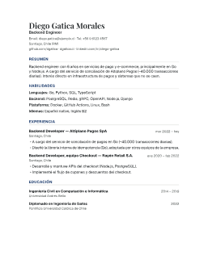 | **Toga** `ats-toga` Playfair + Geist · Marino | ats | pasa | 1p·10.8 / 1p·10.8 / 1p·10.8 | 2p·10✂ / 2p·10.8 / 2p·10.8 | 4p·10✂ / 4p·10✂ / 4p·10✂ | 86/54/92 | 11.27/17.87/8.91 |
|  | **Expediente** `ats-expediente` Geist · Pizarra | ats | pasa | 1p·10.5 / 1p·10.5 / 1p·10.5 | 2p·10✂ / 2p·10.5 / 2p·10.5 | 4p·10✂ / 4p·10✂ / 4p·10✂ | 86/58/92 | 9.56/17.87/8.91 |
| 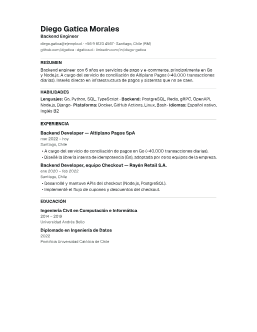 | **Memorando** `ats-memorando` Geist · Tinta neutra | ats | pasa | 1p·10.2 / 1p·10.2 / 1p·10.2 | 2p·10✂ / 2p·10.2 / 2p·10.2 | 4p·10✂ / 4p·10✂ / 4p·10✂ | 89/63/92 | 15.52/17.87/8.03 |
| 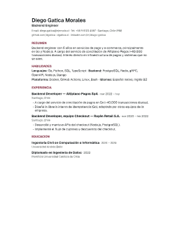 | **Registro** `ats-registro` Geist en dos pesos · Granate | ats | pasa | 1p·10.2 / 1p·10.2 / 1p·10.2 | 2p·10✂ / 2p·10.2 / 2p·10.2 | 4p·10✂ / 4p·10✂ / 4p·10✂ | 84/74/86 | 10.12/17.87/8.91 |
| 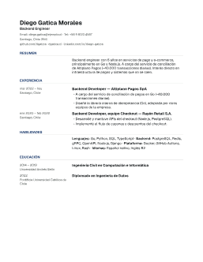 | **Veterana** `ats-veterana` Geist · Marino | ats | pasa | 1p·10.2 / 1p·10.2 / 1p·10.2 | 2p·10✂ / 2p·10.2 / 2p·10.2 | 4p·10✂ / 4p·10✂ / 4p·10✂ | 68/59/70 | 11.27/17.87/8.91 |
| 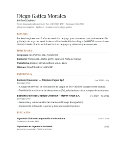 | **Editorial** `ats-editorial` Playfair de titular y encabezado · Cobre | ats | pasa | 1p·11 / 1p·11 / 1p·11 | 2p·10✂ / 2p·10.75 / 3p·11 | 4p·10✂ / 4p·10✂ / 4p·10✂ | 86/58/92 | 6.75/17.87/8.91 |
| 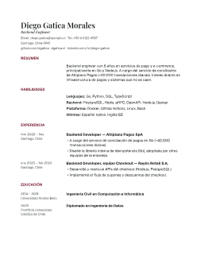 | **Crónica** `ats-cronica` Playfair con subtítulo en cursiva · Granate | ats | pasa | 1p·10.8 / 1p·10.8 / 1p·10.8 | 2p·10✂ / 2p·10.8 / 2p·10.8 | 4p·10✂ / 4p·10✂ / 4p·10✂ | 68/54/70 | 10.12/17.87/8.91 |
| 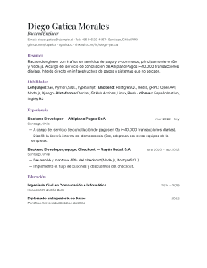 | **Ensayo** `ats-ensayo` Playfair de titular y encabezado · Ciruela | ats | pasa | 1p·11 / 1p·11 / 1p·11 | 2p·10✂ / 2p·11 / 2p·11 | 4p·10✂ / 4p·10✂ / 4p·10✂ | 86/63/92 | 9.83/17.87/8.91 |
| 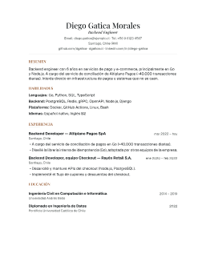 | **Portada** `ats-portada` Playfair de titular y encabezado · Cobre | ats | pasa | 1p·10.8 / 1p·10.8 / 1p·10.8 | 2p·10✂ / 2p·10.8 / 2p·10.8 | 4p·10✂ / 4p·10✂ / 4p·10✂ | 86/54/92 | 6.75/17.87/8.91 |
| 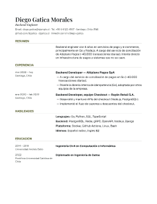 | **Columna** `ats-columna` Playfair con subtítulo en cursiva · Oliva | ats | pasa | 1p·10.8 / 1p·10.8 / 1p·10.8 | 2p·10✂ / 2p·10.8 / 2p·10.8 | 4p·10✂ / 4p·10✂ / 4p·10✂ | 68/58/76 | 8.19/17.87/8.91 |
| 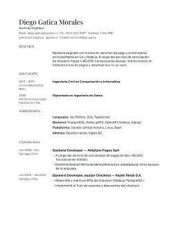 | **Postulación** `ats-postulacion` Playfair de titular y encabezado · Ciruela | ats | pasa | 1p·10.8 / 1p·10.8 / 1p·10.8 | 2p·10✂ / 2p·10.8 / 2p·10.8 | 4p·10✂ / 4p·10✂ / 4p·10✂ | 70/58/77 | 9.83/17.87/8.91 |
| 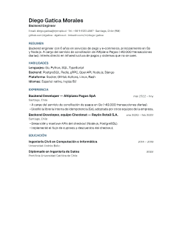 | **Instrumento** `ats-instrumento` Geist en dos pesos · Acero | ats | pasa | 1p·10.2 / 1p·10.2 / 1p·10.2 | 2p·10✂ / 2p·10.2 / 2p·10.2 | 4p·10✂ / 4p·10✂ / 4p·10✂ | 86/58/92 | 7.98/17.87/8.91 |
| 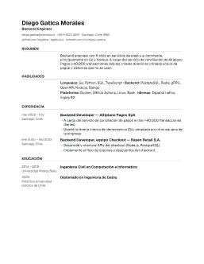 | **Bitácora** `ats-terminal` Geist · Tinta neutra | ats | pasa | 1p·10.2 / 1p·10.2 / 1p·10.2 | 2p·10✂ / 2p·10.2 / 2p·10.2 | 4p·10✂ / 4p·10✂ / 4p·10✂ | 76/62/81 | 15.52/17.87/8.03 |
| 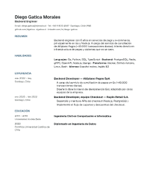 | **Tablero** `ats-consola` Geist en dos pesos · Acero | ats | pasa | 1p·10.2 / 1p·10.2 / 1p·10.2 | 2p·10✂ / 2p·10.2 / 2p·10.2 | 4p·10✂ / 4p·10✂ / 4p·10✂ | 68/60/76 | 7.98/17.87/8.91 |
| 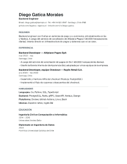 | **Esquema** `ats-esquema` Geist en dos pesos · Pizarra | ats | pasa | 1p·10.5 / 1p·10.5 / 1p·10.5 | 2p·10✂ / 2p·10.5 / 2p·10.5 | 4p·10✂ / 4p·10✂ / 4p·10✂ | 86/58/92 | 9.56/17.87/8.91 |
| 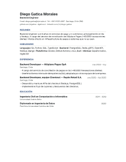 | **Telemetría** `ats-telemetria` Geist en dos pesos · Marino | ats | pasa | 1p·10.2 / 1p·10.2 / 1p·10.2 | 2p·10✂ / 2p·10.2 / 2p·10.2 | 4p·10✂ / 4p·10✂ / 4p·10✂ | 89/63/92 | 11.27/17.87/8.91 |
| 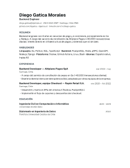 | **Taller** `ats-taller` Geist · Pizarra | ats | pasa | 1p·10.5 / 1p·10.5 / 1p·10.5 | 2p·10✂ / 2p·10.5 / 2p·10.5 | 4p·10✂ / 4p·10✂ / 4p·10✂ | 89/63/92 | 9.56/17.87/8.91 |
| 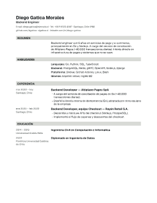 | **Banco de pruebas** `ats-banco` Geist · Acero | ats | pasa | 1p·10.2 / 1p·10.2 / 1p·10.2 | 2p·10✂ / 2p·10.2 / 2p·10.2 | 4p·10✂ / 4p·10✂ / 4p·10✂ | 70/58/77 | 7.98/17.87/8.91 |
| 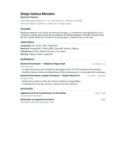 | **Compacta** `ats-compacta` Geist · Tinta neutra | ats | pasa | 1p·10 / 1p·10 / 1p·10 | 2p·10✂ / 2p·10 / 2p·10 | 3p·10✂ / 3p·10✂ / 3p·10 | 86/58/92 | 15.52/17.87/8.03 |
| 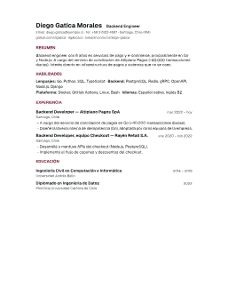 | **Compacta máxima** `ats-compacta-maxima` Geist · Granate | ats | pasa | 1p·10.2 / 1p·10.2 / 1p·10.2 | 2p·10✂ / 2p·10.2 / 2p·10.2 | 4p·10✂ / 4p·10✂ / 4p·10✂ | 86/63/92 | 10.12/17.87/8.91 |
| 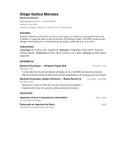 | **Mínima** `ats-minima` Geist · Tinta neutra | ats | pasa | 1p·10.2 / 1p·10.2 / 1p·10.2 | 2p·10✂ / 2p·10.2 / 2p·10.2 | 4p·10✂ / 4p·10✂ / 4p·10✂ | 89/62/92 | 15.52/17.87/8.03 |
| 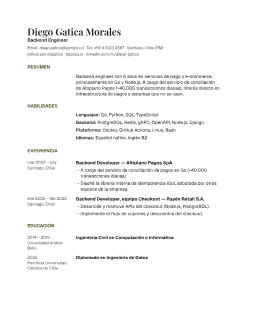 | **Hoja** `ats-hoja` Playfair + Geist · Oliva | ats | pasa | 1p·10.8 / 1p·10.8 / 1p·10.8 | 2p·10✂ / 2p·10.8 / 2p·10.8 | 4p·10✂ / 4p·10✂ / 4p·10✂ | 69/58/76 | 8.19/17.87/8.91 |
| 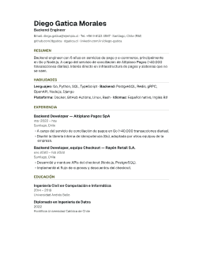 | **Margen** `ats-margen` Geist · Oliva | ats | pasa | 1p·10.5 / 1p·10.5 / 1p·10.5 | 2p·10✂ / 2p·10.5 / 2p·10.5 | 4p·10✂ / 4p·10✂ / 4p·10✂ | 84/63/86 | 8.19/17.87/8.91 |
| 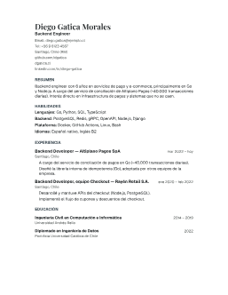 | **Silencio** `ats-silencio` Playfair + Geist · Pizarra | ats | pasa | 1p·10.5 / 1p·10.5 / 1p·10.5 | 2p·10✂ / 2p·10.5 / 2p·10.5 | 4p·10✂ / 4p·10✂ / 4p·10✂ | 83/54/89 | 9.56/17.87/8.91 |
| 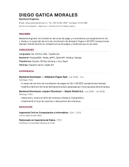 | **Titular** `ats-titular` Geist · Granate | ats | pasa | 1p·10.5 / 1p·10.5 / 1p·10.5 | 2p·10✂ / 2p·10.5 / 2p·10.5 | 4p·10✂ / 4p·10✂ / 4p·10✂ | 86/59/92 | 10.12/17.87/8.91 |
| 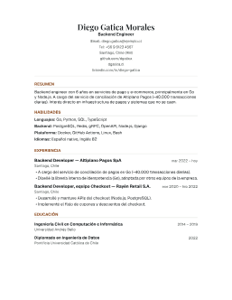 | **Bandera** `ats-bandera` Playfair + Geist · Cobre | ats | pasa | 1p·10.5 / 1p·10.5 / 1p·10.5 | 2p·10✂ / 2p·10.5 / 2p·10.5 | 4p·10✂ / 4p·10✂ / 4p·10✂ | 86/57/92 | 6.75/17.87/8.91 |
| 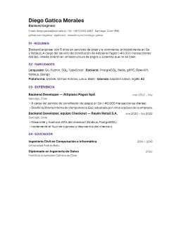 | **Pauta** `ats-pauta` Geist · Ciruela | ats | pasa | 1p·10.2 / 1p·10.2 / 1p·10.2 | 2p·10✂ / 2p·10.2 / 2p·10.2 | 4p·10✂ / 4p·10✂ / 4p·10✂ | 86/63/92 | 9.83/17.87/8.91 |
| 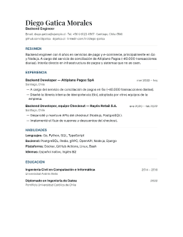 | **Cornisa** `ats-indice` Playfair + Geist · Acero | ats | pasa | 1p·10.8 / 1p·10.8 / 1p·10.8 | 2p·10✂ / 2p·10.8 / 2p·10.8 | 4p·10✂ / 4p·10✂ / 4p·10✂ | 83/58/89 | 7.98/17.87/8.91 |
| 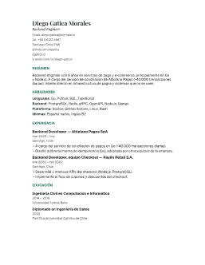 | **Perfil** `ats-perfil` Playfair con subtítulo en cursiva · Pátina | ats | pasa | 1p·10.2 / 1p·10.2 / 1p·10.2 | 2p·10✂ / 2p·10.2 / 2p·10.2 | 4p·10✂ / 4p·10✂ / 4p·10✂ | 86/54/92 | 6.11/17.87/8.91 |
| 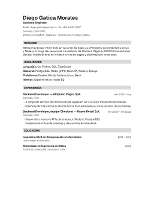 | **Banda** `ats-banda` Geist · Ciruela | ats | pasa | 1p·10.5 / 1p·10.5 / 1p·10.5 | 2p·10✂ / 2p·10.5 / 2p·10.5 | 4p·10✂ / 4p·10✂ / 4p·10✂ | 86/57/92 | 9.83/17.87/8.91 |
| 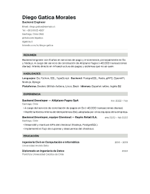 | **Banda con foto** `ats-banda-foto` Geist · Ciruela | ats | pasa | 1p·10.5 / 1p·10.5 / 1p·10.5 | 2p·10✂ / 2p·10.5 / 2p·10.5 | 4p·10✂ / 4p·10✂ / 4p·10✂ | 86/63/92 | 9.83/17.87/8.91 |
| 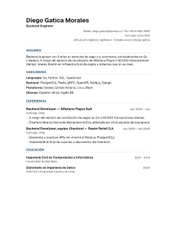 | **Credencial** `ats-credencial` Geist · Acero | ats | pasa | 1p·10.5 / 1p·10.5 / 1p·10.5 | 2p·10✂ / 2p·10.5 / 2p·10.5 | 4p·10✂ / 4p·10✂ / 4p·10✂ | 86/57/92 | 7.98/17.87/8.91 |
| 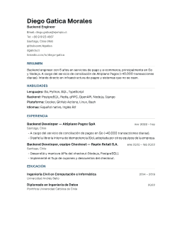 | **Credencial con foto** `ats-credencial-foto` Geist · Acero | ats | pasa | 1p·10.5 / 1p·10.5 / 1p·10.5 | 2p·10✂ / 2p·10.5 / 2p·10.5 | 4p·10✂ / 4p·10✂ / 4p·10✂ | 86/54/92 | 7.98/17.87/8.91 |
| 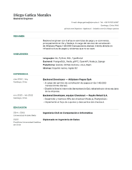 | **Retrato** `ats-retrato` Playfair + Geist · Pátina | ats | pasa | 1p·10.2 / 1p·10.2 / 1p·10.2 | 2p·10✂ / 2p·10.2 / 2p·10.2 | 4p·10✂ / 4p·10✂ / 4p·10✂ | 68/54/77 | 6.11/17.87/8.91 |
| 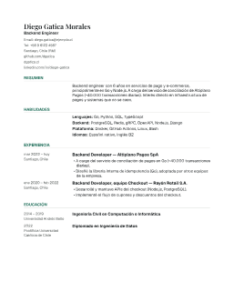 | **Retrato con foto** `ats-retrato-foto` Playfair + Geist · Pátina | ats | pasa | 1p·10.2 / 1p·10.2 / 1p·10.2 | 2p·10✂ / 2p·10.2 / 2p·10.2 | 4p·10✂ / 4p·10✂ / 4p·10✂ | 76/54/81 | 6.11/17.87/8.91 |
| 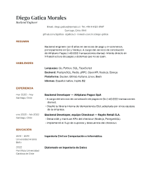 | **Dossier** `ats-dossier` Playfair con subtítulo en cursiva · Cobre | ats | pasa | 1p·10.5 / 1p·10.5 / 1p·10.5 | 2p·10✂ / 2p·10.5 / 2p·10.5 | 4p·10✂ / 4p·10✂ / 4p·10✂ | 70/54/77 | 6.75/17.87/8.91 |
| 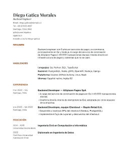 | **Dossier con foto** `ats-dossier-foto` Playfair con subtítulo en cursiva · Cobre | ats | pasa | 1p·10.5 / 1p·10.5 / 1p·10.5 | 2p·10✂ / 2p·10.5 / 2p·10.5 | 4p·10✂ / 4p·10✂ / 4p·10✂ | 70/54/77 | 6.75/17.87/8.91 |
| 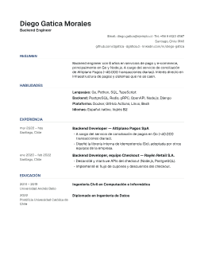 | **Consultora** `ats-consultora` Geist en dos pesos · Marino | ats | pasa | 1p·10.5 / 1p·10.5 / 1p·10.5 | 2p·10✂ / 2p·10.5 / 2p·10.5 | 4p·10✂ / 4p·10✂ / 4p·10✂ | 68/54/70 | 11.27/17.87/8.91 |
| 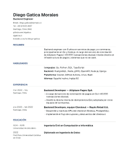 | **Consultora con foto** `ats-consultora-foto` Geist en dos pesos · Marino | ats | pasa | 1p·10.5 / 1p·10.5 / 1p·10.5 | 2p·10✂ / 2p·10.5 / 2p·10.5 | 4p·10✂ / 4p·10✂ / 4p·10✂ | 68/51/70 | 11.27/17.87/8.91 |
| 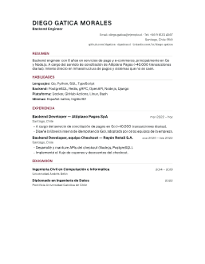 | **Cabecera** `ats-cabecera` Geist en dos pesos · Granate | ats | pasa | 1p·10.2 / 1p·10.2 / 1p·10.2 | 2p·10✂ / 2p·10.2 / 2p·10.2 | 4p·10✂ / 4p·10✂ / 4p·10✂ | 86/57/92 | 10.12/17.87/8.91 |
| 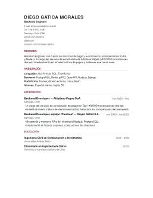 | **Cabecera con foto** `ats-cabecera-foto` Geist en dos pesos · Granate | ats | pasa | 1p·10.2 / 1p·10.2 / 1p·10.2 | 2p·10✂ / 2p·10.2 / 2p·10.2 | 4p·10✂ / 4p·10✂ / 4p·10✂ | 86/57/92 | 10.12/17.87/8.91 |
| 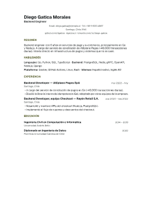 | **Ficha** `ats-ficha` Geist · Oliva | ats | pasa | 1p·10.2 / 1p·10.2 / 1p·10.2 | 2p·10✂ / 2p·10.2 / 2p·10.2 | 4p·10✂ / 4p·10✂ / 4p·10✂ | 86/62/92 | 8.19/17.87/8.91 |
| 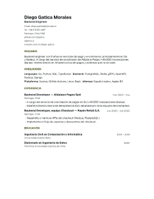 | **Ficha con foto** `ats-ficha-foto` Geist · Oliva | ats | pasa | 1p·10.2 / 1p·10.2 / 1p·10.2 | 2p·10✂ / 2p·10.2 / 2p·10.2 | 4p·10✂ / 4p·10✂ / 4p·10✂ | 86/63/92 | 8.19/17.87/8.91 |
| 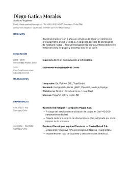 | **Académica** `ats-academica` Playfair con subtítulo en cursiva · Marino | ats | pasa | 1p·10.8 / 1p·10.8 / 1p·10.8 | 2p·10✂ / 2p·10.8 / 2p·10.8 | 4p·10✂ / 4p·10✂ / 4p·10✂ | 69/58/76 | 11.27/17.87/8.91 |
| 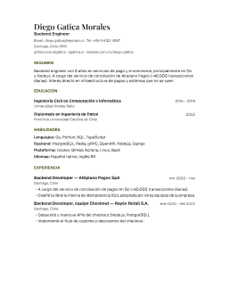 | **Primer empleo** `ats-primer-empleo` Playfair + Geist · Oliva | ats | pasa | 1p·10.5 / 1p·10.5 / 1p·10.5 | 2p·10✂ / 2p·10.5 / 2p·10.5 | 4p·10✂ / 4p·10✂ / 4p·10✂ | 86/57/92 | 8.19/17.87/8.91 |
| 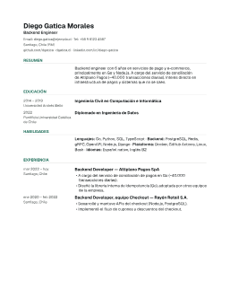 | **Egresado** `ats-egresado` Geist · Pátina | ats | pasa | 1p·10.2 / 1p·10.2 / 1p·10.2 | 2p·10✂ / 2p·10.2 / 2p·10.2 | 4p·10✂ / 4p·10✂ / 4p·10✂ | 70/59/77 | 6.11/17.87/8.91 |
| 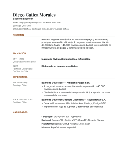 | **Chilena** `ats-chile` Playfair + Geist · Cobre | ats | pasa | 1p·10.5 / 1p·10.5 / 1p·10.5 | 2p·10✂ / 2p·10.5 / 2p·10.5 | 4p·10✂ / 4p·10✂ / 4p·10✂ | 68/54/70 | 6.75/17.87/8.91 |
| 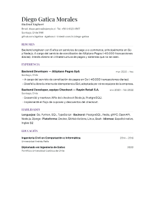 | **Portafolio** `ats-portafolio` Playfair de titular y encabezado · Ciruela | ats | pasa | 1p·10.8 / 1p·10.8 / 1p·10.8 | 2p·10✂ / 2p·10.8 / 2p·10.8 | 4p·10✂ / 4p·10✂ / 4p·10✂ | 89/62/92 | 9.83/17.87/8.91 |
| 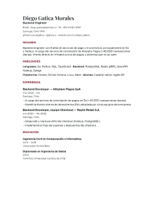 | **Transición** `ats-transicion` Playfair + Geist · Granate | ats | pasa | 1p·10.5 / 1p·10.5 / 1p·10.5 | 2p·10✂ / 2p·10.5 / 2p·10.5 | 4p·10✂ / 4p·10✂ / 4p·10✂ | 86/62/92 | 10.12/17.87/8.91 |
| 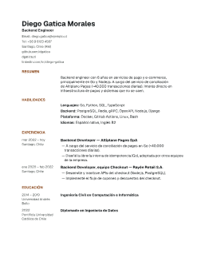 | **Puente** `ats-puente` Geist · Cobre | ats | pasa | 1p·10.5 / 1p·10.5 / 1p·10.5 | 2p·10✂ / 2p·10.5 / 2p·10.5 | 4p·10✂ / 4p·10✂ / 4p·10✂ | 68/54/77 | 6.75/17.87/8.91 |
| 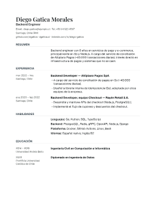 | **Trayectoria** `ats-trayectoria` Playfair + Geist · Pizarra | ats | pasa | 1p·10.8 / 1p·10.8 / 1p·10.8 | 2p·10✂ / 2p·10.8 / 2p·10.8 | 4p·10✂ / 4p·10✂ / 4p·10✂ | 68/54/70 | 9.56/17.87/8.91 |
|  | **Laboratorio** `ats-laboratorio` Geist en dos pesos · Oliva | ats | pasa | 1p·10.2 / 1p·10.2 / 1p·10.2 | 2p·10✂ / 2p·10.2 / 2p·10.2 | 3p·10✂ / 3p·10✂ / 3p·10.2 | 76/62/81 | 8.19/17.87/8.91 |
|  | **Oro viejo** `ats-oro-viejo` Spectral + Geist · Oro viejo | ats | pasa | 1p·10.8 / 1p·10.8 / 1p·10.8 | 2p·10✂ / 2p·10.8 / 2p·10.8 | 4p·10✂ / 4p·10✂ / 4p·10✂ | 84/63/89 | 6.36/17.87/8.91 |
|  | **Notaría** `ats-notaria` IBM Plex Serif · Burdeos | ats | pasa | 1p·10.5 / 1p·10.5 / 1p·10.5 | 2p·10✂ / 2p·10.5 / 2p·10.5 | 4p·10✂ / 4p·10✂ / 4p·10✂ | 83/58/89 | 11.61/17.87/8.91 |
|  | **Tinta azul** `ats-tinta-azul` Plex Serif + Geist · Azul tinta | ats | pasa | 1p·10.2 / 1p·10.2 / 1p·10.2 | 2p·10✂ / 2p·10.2 / 2p·10.2 | 4p·10✂ / 4p·10✂ / 4p·10✂ | 68/54/70 | 14.15/17.87/8.91 |
|  | **Verde botella** `ats-botella` Crimson Text + Geist · Verde botella | ats | pasa | 1p·10.8 / 1p·10.8 / 1p·10.8 | 2p·10✂ / 2p·10.8 / 2p·10.8 | 4p·10✂ / 4p·10✂ / 4p·10✂ | 86/54/92 | 10.09/17.87/8.91 |
|  | **Grafito cálido** `ats-grafito-calido` IBM Plex Serif · Grafito cálido | ats | pasa | 1p·10.2 / 1p·10.2 / 1p·10.2 | 2p·10✂ / 2p·10.2 / 2p·10.2 | 4p·10✂ / 4p·10✂ / 4p·10✂ | 84/64/89 | 10.26/17.87/9.17 |
|  | **Lámina** `ats-lamina` IBM Plex Serif · Oro viejo | ats | pasa | 1p·10.5 / 1p·10.5 / 1p·10.5 | 2p·10✂ / 2p·10.5 / 2p·10.5 | 4p·10✂ / 4p·10✂ / 4p·10✂ | 69/58/76 | 6.36/17.87/8.91 |
|  | **Sello** `ats-sello` Spectral + Geist · Oro viejo | ats | pasa | 1p·10.2 / 1p·10.2 / 1p·10.2 | 2p·10✂ / 2p·10.2 / 2p·10.2 | 4p·10✂ / 4p·10✂ / 4p·10✂ | 69/62/76 | 6.36/17.87/8.91 |
|  | **Despacho** `ats-despacho` Crimson Text + Geist · Burdeos | ats | pasa | 1p·10.2 / 1p·10.2 / 1p·10.2 | 2p·10✂ / 2p·10.2 / 2p·10.2 | 4p·10✂ / 4p·10✂ / 4p·10✂ | 86/54/92 | 11.61/17.87/8.91 |
|  | **Lateral (con foto)** `visual-lateral` Playfair + Geist · Pátina | visual (round-trip exento) | pasa | 1p·10.5 / 1p·10.5 / 1p·10.5 | 2p·10✂ / 2p·10.5 / 2p·10.5 | 4p·10✂ / 4p·10✂ / 4p·10✂ | 68/51/70 | 6.11/17.87/8.91 |
|  | **Dossier (con foto)** `visual-dossier` Playfair de titular y encabezado · Ciruela | visual (round-trip exento) | pasa | 1p·10.8 / 1p·10.8 / 1p·10.8 | 2p·10✂ / 2p·10.8 / 2p·10.8 | 4p·10✂ / 4p·10✂ / 4p·10✂ | 68/51/70 | 9.83/17.87/8.91 |
|  | **Ficha (con foto)** `visual-ficha` Geist Mono de titular · Granate | visual (round-trip exento) | pasa | 1p·10.2 / 1p·10.2 / 1p·10.2 | 2p·10✂ / 2p·10.2 / 2p·10.2 | 4p·10✂ / 4p·10✂ / 4p·10✂ | 68/59/70 | 10.12/17.87/8.91 |
|  | **Cartel (sin rótulos)** `visual-cartel` Playfair + Geist · Oliva | visual (round-trip exento) | pasa | 1p·11 / 1p·11 / 1p·11 | 2p·10✂ / 2p·11 / 2p·11 | 4p·10✂ / 4p·10✂ / 4p·10✂ | 83/57/89 | 8.19/17.87/8.91 |
|  | **Clásica + sangriaReducida** `u:audit-ats-clasica-sangriaReducida` Playfair + Geist · Pátina modos: sangriaReducida | ats | pasa | 1p·10.5 / 1p·10.5 / 1p·10.5 | 2p·10✂ / 2p·10.5 / 2p·10.5 | 4p·10✂ / 4p·10✂ / 4p·10✂ | 86/58/92 | 6.11/17.87/8.91 |
|  | **Clásica + espacioCompacto** `u:audit-ats-clasica-espacioCompacto` Playfair + Geist · Pátina modos: espacioCompacto | ats | pasa | 1p·10.5 / 1p·10.5 / 1p·10.5 | 2p·10✂ / 2p·10.5 / 2p·10.5 | 4p·10✂ / 4p·10✂ / 4p·10✂ | 86/58/92 | 6.11/17.87/8.91 |
|  | **Clásica + habilidadesEnLinea** `u:audit-ats-clasica-habilidadesEnLinea` Playfair + Geist · Pátina modos: habilidadesEnLinea | ats | pasa | 1p·10.5 / 1p·10.5 / 1p·10.5 | 2p·10✂ / 2p·10.5 / 2p·10.5 | 4p·10✂ / 4p·10✂ / 4p·10✂ | 86/58/92 | 6.11/17.87/8.91 |
|  | **Clásica + fechaLugarDerecha** `u:audit-ats-clasica-fechaLugarDerecha` Playfair + Geist · Pátina modos: fechaLugarDerecha | ats | pasa | 1p·10.5 / 1p·10.5 / 1p·10.5 | 2p·10✂ / 2p·10.5 / 2p·10.5 | 4p·10✂ / 4p·10✂ / 4p·10✂ | 86/47/92 | 6.11/17.87/8.91 |
|  | **Clásica + cabeceraCompacta** `u:audit-ats-clasica-cabeceraCompacta` Playfair + Geist · Pátina modos: cabeceraCompacta | ats | pasa | 1p·10.5 / 1p·10.5 / 1p·10.5 | 2p·10✂ / 2p·10.5 / 2p·10.5 | 4p·10✂ / 4p·10✂ / 4p·10✂ | 86/59/92 | 6.11/17.87/8.91 |
|  | **Clásica · a medida en su límite** `u:borrador-h4sqpr` Playfair + Geist · Pátina modos: sangriaReducida · espacioCompacto · habilidadesEnLinea · fechaLugarDerecha · cabeceraCompacta | ats | pasa | 1p·10 / 1p·10 / 1p·10 | 2p·10✂ / 2p·10 / 2p·10 | 3p·10✂ / 3p·10✂ / 3p·10 | 86/47/92 | 6.11/17.87/8.91 |
|  | **Expediente + sangriaReducida** `u:audit-ats-expediente-sangriaReducida` Geist · Pizarra modos: sangriaReducida | ats | pasa | 1p·10.5 / 1p·10.5 / 1p·10.5 | 2p·10✂ / 2p·10.5 / 2p·10.5 | 4p·10✂ / 4p·10✂ / 4p·10✂ | 86/58/92 | 9.56/17.87/8.91 |
|  | **Expediente + espacioCompacto** `u:audit-ats-expediente-espacioCompacto` Geist · Pizarra modos: espacioCompacto | ats | pasa | 1p·10.5 / 1p·10.5 / 1p·10.5 | 2p·10✂ / 2p·10.5 / 2p·10.5 | 4p·10✂ / 4p·10✂ / 4p·10✂ | 86/58/92 | 9.56/17.87/8.91 |
|  | **Expediente + habilidadesEnLinea** `u:audit-ats-expediente-habilidadesEnLinea` Geist · Pizarra modos: habilidadesEnLinea | ats | pasa | 1p·10.5 / 1p·10.5 / 1p·10.5 | 2p·10✂ / 2p·10.5 / 2p·10.5 | 4p·10✂ / 4p·10✂ / 4p·10✂ | 86/58/92 | 9.56/17.87/8.91 |
|  | **Expediente + fechaLugarDerecha** `u:audit-ats-expediente-fechaLugarDerecha` Geist · Pizarra modos: fechaLugarDerecha | ats | pasa | 1p·10.5 / 1p·10.5 / 1p·10.5 | 2p·10✂ / 2p·10.5 / 2p·10.5 | 4p·10✂ / 4p·10✂ / 4p·10✂ | 86/47/92 | 9.56/17.87/8.91 |
|  | **Expediente + cabeceraCompacta** `u:audit-ats-expediente-cabeceraCompacta` Geist · Pizarra modos: cabeceraCompacta | ats | pasa | 1p·10.5 / 1p·10.5 / 1p·10.5 | 2p·10✂ / 2p·10.5 / 2p·10.5 | 4p·10✂ / 4p·10✂ / 4p·10✂ | 86/58/92 | 9.56/17.87/8.91 |
|  | **Expediente · a medida en su límite** `u:borrador-1hwh21w` Geist · Pizarra modos: sangriaReducida · espacioCompacto · habilidadesEnLinea · fechaLugarDerecha · cabeceraCompacta | ats | pasa | 1p·10 / 1p·10 / 1p·10 | 2p·10✂ / 2p·10 / 2p·10 | 3p·10✂ / 3p·10✂ / 3p·10 | 86/47/92 | 9.56/17.87/8.91 |
|  | **Veterana + sangriaReducida** `u:audit-ats-veterana-sangriaReducida` Geist · Marino modos: sangriaReducida | ats | pasa | 1p·10.2 / 1p·10.2 / 1p·10.2 | 2p·10✂ / 2p·10.2 / 2p·10.2 | 4p·10✂ / 4p·10✂ / 4p·10✂ | 68/59/70 | 11.27/17.87/8.91 |
|  | **Veterana + espacioCompacto** `u:audit-ats-veterana-espacioCompacto` Geist · Marino modos: espacioCompacto | ats | pasa | 1p·10.2 / 1p·10.2 / 1p·10.2 | 2p·10✂ / 2p·10.2 / 2p·10.2 | 4p·10✂ / 4p·10✂ / 4p·10✂ | 68/59/70 | 11.27/17.87/8.91 |
|  | **Veterana + habilidadesEnLinea** `u:audit-ats-veterana-habilidadesEnLinea` Geist · Marino modos: habilidadesEnLinea | ats | pasa | 1p·10.2 / 1p·10.2 / 1p·10.2 | 2p·10✂ / 2p·10.2 / 2p·10.2 | 4p·10✂ / 4p·10✂ / 4p·10✂ | 68/59/70 | 11.27/17.87/8.91 |
|  | **Veterana + cabeceraCompacta** `u:audit-ats-veterana-cabeceraCompacta` Geist · Marino modos: cabeceraCompacta | ats | pasa | 1p·10.2 / 1p·10.2 / 1p·10.2 | 2p·10✂ / 2p·10.2 / 2p·10.2 | 4p·10✂ / 4p·10✂ / 4p·10✂ | 69/62/76 | 11.27/17.87/8.91 |
|  | **Veterana · a medida en su límite** `u:borrador-1kr4clh` Geist · Marino modos: sangriaReducida · espacioCompacto · habilidadesEnLinea · cabeceraCompacta | ats | pasa | 1p·10 / 1p·10 / 1p·10 | 2p·10✂ / 2p·10 / 2p·10 | 3p·10✂ / 3p·10✂ / 3p·10 | 81/62/83 | 11.27/17.87/8.91 |
